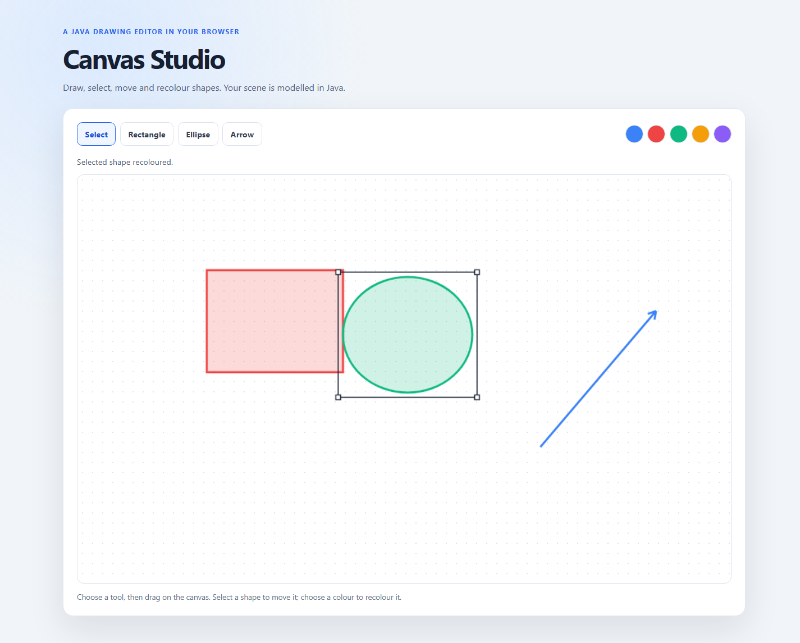

# Article support: TeaVM drawing app

## Architecture

`DrawingModel` stores ordered Java shape objects and the selected shape. `DrawingController` handles tool state and pointer gestures; `DrawingRenderer` clears and redraws the canvas from the model after each interaction. `DrawingApp` wires HTML controls and browser events. TeaVM 0.16.0's JSO bindings provide the DOM, `EventListener` and Canvas 2D APIs. The small `CanvasInterop` class uses `@JSBody` only for PointerEvent properties and pointer capture, for which this JSO version has no typed PointerEvent wrapper.

The module uses the repository's Java 17 and Maven conventions, with versions inherited from the root POM. It has no server dependency: TeaVM emits a static browser app into `target/javascript`, which can be served with Python's built-in HTTP server.

## Shape representation and movement

From `DrawingShape.java`, arrows retain their directed endpoints while other shapes derive normalized bounds from the same geometry:

```java
public double getLeft() {
    return Math.min(startX, endX);
}

public double getTop() {
    return Math.min(startY, endY);
}

public void moveBy(double deltaX, double deltaY) {
    startX += deltaX;
    endX += deltaX;
    startY += deltaY;
    endY += deltaY;
}
```

Hit testing is model logic: rectangles test normalized bounds, ellipses test the normalized ellipse equation, and arrows test distance to their directed line segment with an 8-pixel tolerance. Overlap selection scans the list in reverse, matching the renderer's topmost-first behavior.

## Browser interop

TeaVM JSO `CanvasRenderingContext2D` exposes the Canvas methods used for clearing, paths, ellipses and fills. `HTMLCanvasElement.getContext("2d")` is checked at startup; absent required DOM elements and a missing context raise `IllegalStateException` instead of silently leaving a blank app. Pointer listeners use the supported `EventListener<Event>` callback. Pointer coordinates are read at the interop boundary and scaled to intrinsic canvas coordinates:

```java
@JSBody(params = { "canvas", "event" }, script = """
        const bounds = canvas.getBoundingClientRect();
        return (event.clientX - bounds.left) * canvas.width / bounds.width;
        """)
static native double canvasX(HTMLCanvasElement canvas, Event event);

@JSBody(params = { "canvas", "event" }, script = """
        canvas.setPointerCapture(event.pointerId);
        """)
static native void capturePointer(HTMLCanvasElement canvas, Event event);
```

The matching `canvasY` method performs the same scaling vertically. Pointer capture delivers movement and release when dragging outside the canvas; `pointercancel` discards the current preview.

## Interaction and rendering

From `DrawingController.java`, pointer movement updates a provisional shape or moves the selected model object by the pointer delta:

```java
public void pointerMove(double x, double y) {
    if (preview != null) {
        preview.setEnd(x, y);
    } else if (moving) {
        model.moveSelectedBy(x - lastX, y - lastY);
    }
    lastX = x;
    lastY = y;
}
```

On release, sufficiently large previews are added to the model; selecting a new drawing tool clears the previous selection. The renderer clears the whole canvas, paints committed shapes in list order, then draws a preview and selection handles. Palette clicks update a selected model shape only.

## Build and run

From the repository root, use the verified command:

```sh
mvn -pl teavm-showcase-drawing-app -am clean verify
```

Serve the generated app:

```sh
python -m http.server 8000 --directory teavm-showcase-drawing-app/target/javascript
```

Then open <http://localhost:8000/>.

## Verification record

- `mvn -pl teavm-showcase-drawing-app -am clean verify` — passed, including Maven compilation, TeaVM 0.16.0 JavaScript generation and all 9 model/controller tests (0 failures, 0 errors, 0 skipped).
- The generated page was served at `http://localhost:8000/` with `python -m http.server 8000 --directory teavm-showcase-drawing-app/target/javascript`.
- Browser: Chrome Headless 155.0.8059.39 at a 1440 × 1000 viewport. Confirmed a 2D context, rectangle/ellipse/arrow drawing, reverse-direction ellipse geometry, selecting and moving a shape, red and green recolouring, and continued movement after dragging outside the canvas. No browser console errors or runtime exceptions were reported.
- Screenshot captured from the running app after drawing a red rectangle, a selected green ellipse and a blue arrow:



## Limitations

There is no persistence, undo/redo, resizing, export or advanced path hit testing. Arrow hit testing considers the shaft segment (not a separate polygon for the arrowhead). The app has been kept intentionally small for the article; rerun the documented checks and refresh this evidence if the implementation changes.
